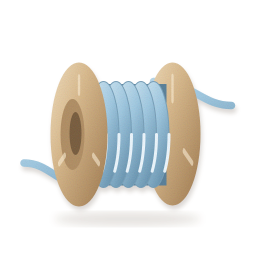

<p align="center">
  
</p>

# Bobbin

Bobbin is a self-hosted webhook inbox and relay. It gives each integration a stable URL, stores the
requests sent to it, and lets you inspect and replay them without a RequestBin or tunnel workflow.

Bobbin runs as a single-tenant app in your own Laravel Cloud account. It currently provides:

- Named endpoints with public, hard-to-guess capture URLs.
- Durable request methods, query strings, headers, bodies, and receipt times.
- Per-endpoint retention from 1 to 365 days, with a 30-day default.
- Optional header and body redaction before a request is stored.
- Replay a selected capture to one configured destination with retries and visible delivery status.

Delivery is at-least-once. A destination may process a request before Bobbin records success, so a
receiver must tolerate duplicates. Bobbin does not yet support fan-out, payload transformations, or
vendor-specific signature verification.

## The Easy Way: Scalpels

[Scalpels](https://scalpels.app) is the guided way to install Bobbin and connect it to your Laravel
Cloud account. Use it if you do not want to provision and connect the app by hand. Bobbin still runs
inside your account, using resources you control.

## Run It Yourself

### Prerequisites

- PHP 8.3 or newer, with the extensions required by Laravel and `ext-gmp`.
- Composer 2.
- SQLite support for local development.
- A Laravel Cloud account and the Laravel Cloud CLI for deployment.

Bobbin has no Node, npm, Vite, or frontend build step. Its compiled assets are committed to the
repository.

### Local Setup

1. Clone the repository and enter it.

   ```bash
   git clone https://github.com/artisan-build/bobbin.git
   cd bobbin
   ```

2. Install the locked dependencies, create `.env`, generate an application key, and migrate the local
   SQLite database.

   ```bash
   composer setup
   ```

   A successful run ends with all migrations marked `DONE`.

3. Create the local Owner account. The command prompts for an email, name, and password.

   ```bash
   php artisan create-admin --local
   ```

   Keep `--local` here. Without it, this Built for Cloud command can select and change a Laravel Cloud
   environment instead of your local database.

4. Attach that Owner to Bobbin's single team. Replace the example email with the address from step 3.

   ```bash
   export BOBBIN_OWNER_EMAIL=you@example.com
   php artisan tinker --execute='$userId = ArtisanBuild\BuiltForCloud\User::query()->where("email", getenv("BOBBIN_OWNER_EMAIL"))->value("id") ?? throw new RuntimeException("Owner not found."); Illuminate\Support\Facades\DB::table("team_user")->insertOrIgnore(["team_id" => Illuminate\Support\Facades\DB::table("teams")->value("id"), "user_id" => $userId]); dump("Owner attached to Bobbin team.");'
   ```

   You should see `Owner attached to Bobbin team.`

5. Run the test suite.

   ```bash
   composer test
   ```

   The command clears cached configuration, checks formatting, and runs the Pest tests.

6. Start the web app.

   ```bash
   composer dev
   ```

   Leave this terminal open. The server prints its local URL, normally <http://localhost:8000>.

7. In a second terminal, start the database queue worker. Replays remain queued if this process is not
   running.

   ```bash
   php artisan queue:work
   ```

8. Open <http://localhost:8000/bfc/login> and sign in with the Owner from step 3. Create an endpoint,
   then open **Security settings** to choose retention, redaction, and one replay destination.

9. Copy the endpoint's capture URL and send it a request. The URL contains the endpoint's real public
   identifier; do not type the placeholder below literally.

   ```bash
   curl -i -X POST 'http://localhost:8000/hooks/<public-id>?source=readme' \
     -H 'Content-Type: application/json' \
     --data '{"event":"example"}'
   ```

   Bobbin returns `204 No Content` after the request is stored. Open **View captures** to inspect it.
   From the capture page, choose **Queue replay** and watch delivery history move to `succeeded` or
   `failed`.

### Deploy To Laravel Cloud

These steps require interactive access to your own Laravel Cloud account. They have not been executed
for this repository.

1. Run the guided first deployment from the repository.

   ```bash
   cloud ship
   ```

   Create and attach a database, and enable the scheduler. The scheduler runs Bobbin's daily retention
   cleanup.

2. Bind the checkout to the application if `ship` did not create `.cloud/config.json`.

   ```bash
   cloud repo:config
   ```

3. In Laravel Cloud, add a managed queue and make it the environment's default queue. Bobbin sends
   replay jobs through the queue; do not create a manually scaled background worker.

4. Never set environment variables for a database, cache, queue, or bucket that Laravel Cloud
   provisions. Cloud injects both credentials and selectors such as `DB_CONNECTION`, `CACHE_STORE`,
   `QUEUE_CONNECTION`, and `FILESYSTEM_DISK`. Setting your own values shadows the injected values and
   breaks the resource.

5. Deploy and wait for the deployment to finish.

   ```bash
   cloud deploy -n --open
   cloud deploy:monitor -n
   ```

6. Create the first Owner in the deployed environment. This command intentionally targets Cloud, so
   replace the placeholder with the environment name shown by the CLI and do not add `--local`.

   ```bash
   php artisan create-admin --environment=<cloud-environment>
   ```

7. Attach the deployed Owner to the Bobbin team. Replace both placeholders.

   ```bash
   cloud tinker <cloud-environment> --code='$userId = ArtisanBuild\BuiltForCloud\User::query()->where("email", "you@example.com")->value("id") ?? throw new RuntimeException("Owner not found."); Illuminate\Support\Facades\DB::table("team_user")->insertOrIgnore(["team_id" => Illuminate\Support\Facades\DB::table("teams")->value("id"), "user_id" => $userId]);'
   ```

8. Request `https://<your-host>/up` and expect HTTP `200`. Then sign in at
   `https://<your-host>/bfc/login`, create an endpoint, and repeat the capture example with its HTTPS
   URL. A replay should leave `queued` once the managed queue processes it.

## Interfaces

The browser UI is the management interface. Endpoint creation, capture inspection, security settings,
replay, and delivery history require a signed-in Built for Cloud user.

The capture interface is public and accepts any HTTP method at `/hooks/{publicId}`. A successful capture
returns `204`. Bobbin does not expose an app-specific JSON management API or MCP server in this release.

## Configuration

Local defaults come from `.env.example` and the files under `config/`.

| Variable | Local default | Purpose |
| --- | --- | --- |
| `APP_URL` | `http://localhost` | Base URL used when Bobbin displays capture URLs. |
| `DB_CONNECTION` | `sqlite` | Stores users, endpoints, captures, deliveries, sessions, cache, and local queue jobs. |
| `SESSION_DRIVER` | `database` | Stores local browser sessions. |
| `CACHE_STORE` | `database` | Provides cache locks, including replay overlap protection. |
| `QUEUE_CONNECTION` | `database` | Queues replay deliveries locally. |
| `BOBBIN_ALLOW_PRIVATE_DESTINATIONS` | `false` | Allows local or private replay targets only when this is `true` and `APP_ENV=local`. Never enable it in a deployed environment. |

Laravel Cloud may replace resource-related local defaults through its managed environment file. Let it
do so; do not copy these local resource values into Cloud environment variables.

## Verification

Run the complete repository gate before contributing:

```bash
composer ready
```

Run the live capture-to-replay harness when changing the delivery path:

```bash
php tests/Live/run-replay-status.php
```

The harness creates disposable state, starts Bobbin, a local receiver, and a real database queue worker,
then drives capture and replay. It temporarily enables `BOBBIN_ALLOW_PRIVATE_DESTINATIONS`; that flag is
restricted to `APP_ENV=local` and must stay disabled in deployed environments.

## Troubleshooting

| Symptom | Check |
| --- | --- |
| The UI returns `403` after login | Run the team-attachment command from local step 4 or Cloud step 7 for that user. |
| A replay stays `queued` locally | Start `php artisan queue:work`. |
| A replay stays `queued` in Cloud | Confirm a managed queue is attached, set as default, and processing jobs. Do not set `QUEUE_CONNECTION` yourself. |
| A destination is rejected | Use an absolute HTTP or HTTPS URL with a publicly routable host. Credentials, fragments, URL-template braces, unresolved hosts, and local or private addresses are rejected. |
| A local test receiver is rejected | Prefer the live harness. For manual local-only testing, set `BOBBIN_ALLOW_PRIVATE_DESTINATIONS=true`, run `php artisan config:clear`, and never deploy that setting. |

## License

Bobbin is licensed under the MIT License.
